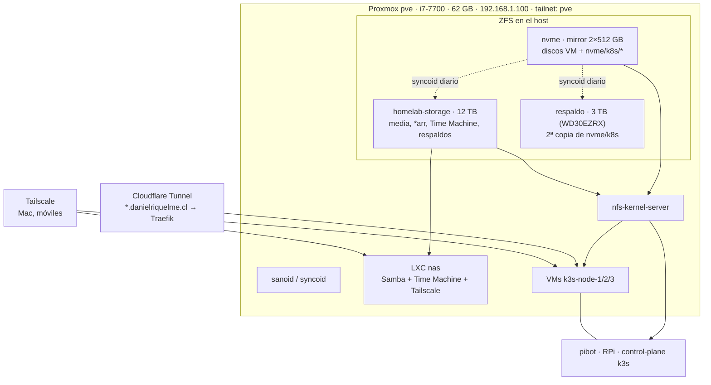

# Arquitectura objetivo del homelab

Versión: 2026-10-01 · Estado: **propuesta** (fase 0 en curso, esperando cables SATA)

## Decisiones de partida

1. **Se retira TrueNAS.** Proxmox gestiona ZFS, NFS y snapshots directamente. La VM 101 fue el punto que se colgó y duplica funciones que el host ya tiene (ZFS, sanoid, NFS, Tailscale).
2. **El disco de 12 TB se sigue usando** (SMART limpio; el problema era cable/puerto/NCQ), pero como **capa masiva y destino de respaldo**, no como única copia de datos irremplazables.
3. **Datos de apps en el NVMe** (mirror), con snapshots y réplica en otros discos.
4. **Las fotos RAW ya tienen copia externa**; aquí solo se necesita acceso para seguir respaldándolas.
5. **Time Machine** sigue disponible por SMB, en LAN y tailnet.
6. **No se rescatan más datos**: media de *arr es reemplazable y queda en el disco de 12 TB.

## Vista general

## Capas de almacenamiento

| Pool | Discos | Uso | Notas |
|---|---|---|---|
| `nvme` | 2 × NVMe 512 GB, mirror | Discos de VMs, `nvme/k8s/<app>` (Immich, Minecraft, Pingvin, futuras apps con datos de valor) | ~260 GB libres; +57 GB al borrar los zvols de TrueNAS |
| `homelab-storage` | Seagate 12 TB (único) | `k8s-media-library` (6.2 TB), `media` (1.7 TB, RAW), `timemachine`, `comfyui`, `backup/` (réplicas y vzdump) | Sin redundancia → solo datos reemplazables o copias. Montaje en `/mnt/homelab-storage` para no cambiar rutas de los PV |
| `respaldo` | WD 3 TB (WD30EZRX, SATA6G_6) | Réplica de `nvme/k8s` y de dumps de Postgres | Disco viejo (1 sector reasignado): es *copia*, nunca original |
| — | WD 2 TB (WD20EURS, SATA6G_5, enlace SATA II 3 Gbps) | **Retirar** del pool (SLOG en HDD no aporta; 89 000 h) | Opcional: tercer destino frío |
| — | ~~SSD 120 GB~~ | **Retirado** (2026-10-01, desgastado) | Reemplazado físicamente por un WD 1 TB de 2,5" (WD10JPVX, SATA6G_4, 19 200 h, SMART limpio), aún con particiones NTFS de Windows y **sin uso asignado**. No sirve como L2ARC (es HDD) |
| — | SSD GIGABYTE 240 GB (SATA6G_1) | Disco de arranque de Proxmox (LVM `pve`: root 38 GB, swap, `local-lvm`) | Fuera de ZFS | Desgastado: 56.5 TB escritos sobre ~40 TBW nominales y 299 cortes de energía. Solo usos donde su falla sea inocua: **nunca** SLOG ni special vdev ni scratch de descargas |

**ARC:** subir `zfs_arc_max` de 1.5 GB a **8 GB** (`/etc/modprobe.d/zfs.conf`). La RAM liberada por la VM de TrueNAS (16 GB) lo permite holgadamente.

## Clasificación de datos y respaldo

| Dato | Ubicación | Snapshots (sanoid) | Copias adicionales | Si se pierde… |
|---|---|---|---|---|
| Immich (fotos subidas) | `nvme/k8s/immich` | horario 24 · diario 14 · semanal 4 · mensual 6 | syncoid → `homelab-storage/backup/k8s` y → `respaldo` · *opcional* offsite (restic) | Irremplazable |
| Minecraft | `nvme/k8s/minecraft` | ídem | ídem | Irremplazable |
| Pingvin | `nvme/k8s/pingvin` | ídem | ídem | Importante |
| Postgres (CNPG) | `local-path` en 3 nodos (replicación) | — | `pg_dumpall` diario → `nvme/k8s/backups/postgres` (entra en la cadena de arriba) | Irremplazable (metadatos Immich) |
| Configs *arr/Plex/Overseerr (SQLite) | `local-path` (no usar NFS: SQLite se corrompe) | zvols de VMs con sanoid (corto plazo) | vzdump semanal de VMs → `homelab-storage/backup/vzdump` | Reconfigurable con esfuerzo |
| etcd k3s | pibot `/var/lib/rancher/k3s/server/db/snapshots` | snapshot k3s cada 12 h | copia a `nvme/k8s/backups/etcd` | Reconstruible, costoso |
| RAW (`media/Raws`) | `homelab-storage/media` | diario 14 · mensual 6 | **copia externa existente** | Hay copia |
| Time Machine | `homelab-storage/timemachine` | semanal 2 | — (es un respaldo) | Se regenera |
| Media *arr | `homelab-storage` (carpeta `k8s-media-library`) | diario 7 (protege borrados) | — | Reemplazable |

Scrub mensual de los tres pools (cron de `zfsutils-linux`). `smartd` + `zed` con alertas (ntfy o correo).

## Servicios de archivos (reemplazo de TrueNAS)

| Función | Antes (TrueNAS) | Después |
|---|---|---|
| NFS para k3s | TrueNAS `192.168.1.20` | `nfs-kernel-server` en el host `192.168.1.100`, `/etc/exports.d/k8s.exports`, solo `192.168.1.0/24` |
| SMB / Time Machine | TrueNAS | **LXC `nas`** (Debian, sin privilegios, idmap de uid/gid 1000) con bind-mounts de `homelab-storage`. Samba con `vfs_fruit` (Time Machine, cuota 1 TB) y share `archivo` (RAW/media). Tailscale dentro del LXC → `nas` en MagicDNS |
| Snapshots / replicación | Tareas TrueNAS | sanoid + syncoid en el host |
| Scripts de respaldo (`/root/scripts`) | cron en TrueNAS | Rescatar del boot-pool de TrueNAS y portar: lo de k8s → `CronJob`; lo de ZFS → host |
| UI web de archivos | — | Opcional: File Browser en el LXC `nas` (solo tailnet) |

Montar desde el Mac (LAN o tailnet): `smb://nas/archivo` y, en Time Machine, `smb://nas/timemachine`.

## Respaldo fuera de casa

Tamaño a respaldar: ~30 GB (Immich 6 GB, Minecraft 0.9 GB, Pingvin 20 GB, dumps de Postgres). Herramienta: **restic** (cifrado, deduplicado, retención) corriendo en el LXC `nas` o como CronJob, leyendo de los snapshots de sanoid.

| Destino | Cómo | Pros | Contras |
|---|---|---|---|
| **iCloud Drive** | restic con backend `rclone:` → rclone `iclouddrive` (soporta subir; compatible con Advanced Data Protection si «Acceder a datos de iCloud en la web» está activo) | Usa espacio del plan iCloud que ya pagas | El token de confianza **dura 30 días**: hay que reautenticar con 2FA cada mes (`rclone reconnect`); si se olvida, el respaldo se detiene en silencio → requiere alerta. API no oficial de Apple, puede romperse |
| **Cloudflare R2** | restic con backend S3 | Ya usas Cloudflare; capa gratuita de 10 GB y sin coste de salida; API S3 estable; sin reautenticación | Por encima de 10 GB se paga (centavos por GB/mes) |
| Backblaze B2 / Hetzner Storage Box | restic S3 / SFTP | Muy barato, estable | Otra cuenta más |

Recomendación: **R2 para lo crítico** (Immich, Minecraft, Postgres ≈ 10 GB, cabe en la capa gratuita) y, si se quiere aprovechar iCloud, como **segundo destino** con alerta si `rclone` pierde la sesión. iCloud Photos no sirve como destino (es de solo lectura vía rclone).

## Kubernetes

- **Nodos:** pibot (RPi, control-plane + etcd) y workers VM 102–104. GPU RTX 3070 en k3s-node-1 (Ollama, Plex, ComfyUI compiten por ella).
- **StorageClasses:**
  - `local-path`: bases de datos replicadas y configs con SQLite.
  - `nfs-proxmox` (PV estáticos): datos de apps en `nvme/k8s/<app>`.
  - `nfs-bulk` (PV estáticos): media en `homelab-storage`; mismas rutas, servidor `192.168.1.100`.
  - Eliminar referencias a `nfs-csi` y `nfs-immich` (no existen como StorageClass ni hay CSI instalado).
- **Exposición:**
  - Pública por túnel con comodín: Immich, Pingvin, Overseerr, Open WebUI, Plex.
  - Solo tailnet (NodePort, sin Ingress): qBittorrent, *arr, ComfyUI, Grafana; o Cloudflare Access si se quieren desde fuera.
- **GitOps:** Flux con SOPS cuando todo lo anterior esté estable (`docs/PENDIENTES.md` §6).
- **Monitoreo:** kube-prometheus-stack + `node_exporter`, `zfs_exporter` y `smartctl_exporter` en el host (`docs/PENDIENTES.md` §5).

## Plan por fases

### Fase 0 — Ahora, sin cables

- [x] Immich, Minecraft y Pingvin en `nvme/k8s` + NFS del host + sanoid.
- [x] Subir ARC a 8 GB (`/etc/modprobe.d/zfs.conf`).
- [x] Pool `respaldo` en `sde` (zstd) + `syncoid-respaldo.timer` diario 03:30; retención réplica 30 d / 8 sem / 12 meses.
- [x] CronJob `immich-db-backup` (03:15, `pg_dump` de la base `immich`, retención 14 días) → `nvme/k8s/backups/postgres`. Réplica corrupta reemplazada (`homelab-postgres-4`), cluster 3/3.
- [x] CronJob `backups/etcd-snapshot-copy` (00:30 y 12:30, en pibot) → `nvme/k8s/backups/etcd` (retención 30 días).
- [x] Rescatado del boot-pool de TrueNAS a `/root/truenas-rescate/` en Proxmox: scripts, `freenas-v1.db`, cronjobs, shares NFS/SMB (texto).
- [x] LXC 110 `nas` (Debian 12, `192.168.1.21`, uids 1000/3000-3002 mapeados 1:1): Samba 4.17 con shares `timemachine` (fruit idéntico a TrueNAS, cuota 1 TB), `archivo` y `prueba` (temporal en `nvme/nas-prueba`). Pendiente: contraseñas SMB y `tailscale up`.
- [ ] Alertas por **Telegram**: `smartd` + `zed` + fallos de sanoid/syncoid/backups (falta token del bot y chat_id).
- [ ] Offsite R2: restic de `nvme/k8s/{immich,minecraft}` + dumps Postgres (falta token de API de Cloudflare con permiso R2).
- [x] Repo: PV de media y ComfyUI con `server: 192.168.1.100` (sin aplicar) + `scripts/fase1-migrar-pvs-nfs.sh` para los 10 PV vivos (incluye 3 que solo existen en el cluster).
- [x] Rama `consolidacion/fase-0` fusionada en `main` (2026-10-01, sin push).

### Fase 1 — Llegan los cables

1. [x] Cambiar cable SATA + poder del 12 TB; BIOS en **AHCI** (2026-10-01; el 12 TB quedó en SATA6G_3 = `ata3`).
2. [x] `dmesg | grep ata3` → enlace a **6.0 Gbps con NCQ (depth 32)** y 0 errores/resets tras el arranque. Vigilar bajo carga (scrub).
3. `zpool import homelab-storage` **en el host, lectura-escritura**; `zfs set mountpoint=/mnt/homelab-storage homelab-storage`.
4. `zpool remove homelab-storage <WD 2 TB>` (quitar SLOG) y el cache del SSD de 120 GB retirado (el pool lo verá como UNAVAIL).
5. `zpool scrub` completo; revisar errores permanentes (esperados: 1 RAW con copia externa, 3 objetos de Time Machine).
6. Exportar por NFS las rutas de media; aplicar manifiestos de *arr/Plex/ComfyUI con el servidor nuevo; escalar a 1.
7. sanoid para `homelab-storage` (política de la tabla) y `syncoid nvme/k8s → homelab-storage/backup/k8s`.

### Fase 2 — Servicios de archivos

1. LXC `nas` con bind-mounts de `homelab-storage/{timemachine,media}`.
2. Share Time Machine (cuota 1 TB) y share `archivo`; probar desde el Mac por LAN y por tailnet.
3. Primera copia de los RAW nuevos al flujo habitual de respaldo externo.

### Fase 3 — Retirar TrueNAS y limpiar

1. Con la réplica en `homelab-storage/backup/k8s` verificada: borrar las copias viejas en `homelab-storage` (`immich-library`, carpeta `minecraft-server` y su dataset vacío con snapshots, `pingvin`, `openclaw`, `photoprism`, `ollama`, `open-webui`, `plex-config`, `system-*`, `temp`, `staging`, `logs`, `config-backups`, `web-backup`, `backup_cleanup_*`, `archived-immich-redis-*`).
2. `qm destroy 101` y plantilla 9001 `truenas-template` (libera ~57 GB en `nvme`). Referencias a TrueNAS en el repo ya eliminadas (2026-10-01: inventario, playbooks, scripts, exporters); queda la skill local `homelab-truenas-api` en `.cursor/`.
3. vzdump semanal de VMs 102–104 → `homelab-storage/backup/vzdump` (retención 4).

### Fase 4 — Operación

1. Flux + SOPS.
2. Monitoreo (Grafana/Prometheus + exporters del host).
3. Rotación de secretos (`.vault_password.txt`, `.truenas-api-key` deja de existir, contraseñas Postgres).
4. Reescribir `docs/` según esta arquitectura.
5. Copia offsite cifrada de `nvme/k8s/{immich,minecraft,pingvin}` y dumps de Postgres (ver «Respaldo fuera de casa»).

## Riesgos que quedan

- **Cortes de energía**: el host se reinició sin apagado ordenado el 2026-10-01 08:04 (el journal se corta sin panic ni error de hardware) y el historial muestra varios reinicios cortos (2026-09-21) y días apagado. El SSD registra 299 cortes inesperados. Recomendación: **UPS** con NUT en Proxmox para apagado ordenado (ya existe `playbook_graceful_shutdown_cluster.yml`).

- **Un solo host físico**: si cae Proxmox cae todo salvo pibot. Mitigación: offsite (fase 4) y vzdump.
- **pibot es único control-plane** (etcd en una Raspberry Pi): respaldo de etcd (fase 0); a futuro, control-plane en una VM.
- **`homelab-storage` sin redundancia**: aceptado porque solo guarda datos reemplazables o copias. Si se quiere proteger media, añadir un segundo disco de 12 TB en mirror.
- **Discos viejos** (WD 2 TB, WD 3 TB): solo como copias; vigilar SMART.

## Decisiones abiertas

- [x] Cuota de Time Machine: **1 TB** (hoy ocupa 476 GB).
- [ ] Destino offsite: iCloud Drive (rclone) vs Cloudflare R2 (ver «Respaldo fuera de casa»).
- [ ] ¿Qué apps de administración necesitan acceso fuera de casa sin Tailscale? (→ Cloudflare Access)
- [x] SSD 120 GB: retirado (2026-10-01). Sin L2ARC por ahora.
- [ ] Uso del WD 1 TB de 2,5" (¿tercer destino frío de respaldo?).
