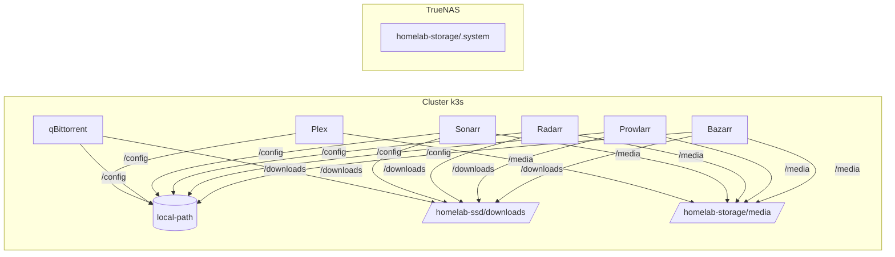
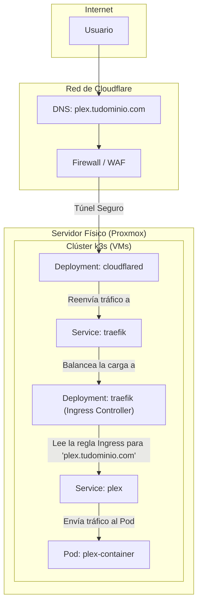

# Documento Maestro de Arquitectura y Metodología: Servidor Homelab v2.0

## 1. Visión General de la Arquitectura

Este documento describe la arquitectura para un servidor doméstico ("homelab") de alto rendimiento y alta disponibilidad. La v2.0 refina el modelo original para adoptar una arquitectura 100% nativa de Kubernetes para la gestión de aplicaciones y red, maximizando la resiliencia y la automatización.

Los principios fundamentales se mantienen:

*   **Virtualización como Base:** Proxmox VE.
*   **Orquestación de Contenedores:** Kubernetes (k3s).
*   **Almacenamiento Centralizado:** TrueNAS CORE.
*   **Gestión Declarativa (GitOps):** ArgoCD.
*   **Automatización de la Infraestructura:** Ansible.

## 2. Diseño Físico y de Almacenamiento

_(Sin cambios respecto a la v1.0)_

### 2.1. Hardware del Servidor
*   **GPU:** NVIDIA GeForce RTX 3070
*   **Discos:** 1x 512GB NVMe, 2x 240GB NVMe, 1x 240GB SATA SSD, 1x 120GB SATA SSD, 1x 12TB HDD, 1x 1.8TB HDD.

### 2.2. Estrategia de Almacenamiento con ZFS
| Pool de ZFS | Discos Físicos | Configuración | Capacidad Usable | Propósito | Resiliencia | Gestionado Por |
| :--- | :--- | :--- | :--- | :--- | :--- | :--- |
| **Pool 1: Sistema/VMs**| 512GB NVMe + 240GB NVMe | **RAID 1 (Espejo)** | ~240GB | Proxmox OS y discos de todas las VMs/LXCs. | **Máxima** | Proxmox (Host) |
| **Pool 2: Descargas** | 240GB SATA SSD | **Standalone** | 240GB | Directorio de descargas rápidas y temporales. | **Bajo** | TrueNAS (VM) |
| **Pool 3: Staging** | 120GB SATA SSD | **Standalone** | 120GB | Área de trabajo para apps de medios. | **Bajo** | TrueNAS (VM) |
| **Pool 4: Medios** | 12TB HDD | **Standalone** | 12TB | Librería de Plex (datos no críticos). | **Bajo** | TrueNAS (VM) |
| **Pool 5: Backups** | 1.8TB HDD | **Standalone** | 1.8TB | Backups del Host Proxmox y de las VMs. | **Crítico** | TrueNAS (VM) |

### 2.3. Política de almacenamiento (actualizada)
- **Configs de apps**: `local-path` (NVMe en nodos k3s). Ej.: Plex, qBittorrent, Sonarr, Radarr, Prowlarr, Bazarr.
- **Descargas compartidas**: `nfs-ssd` (TrueNAS `homelab-ssd` en `/mnt/homelab-ssd/downloads`, RWX).
- **Media Plex**: `nfs-csi` (TrueNAS `homelab-storage` en `/mnt/homelab-storage/media`, RWX).
- **System Dataset TrueNAS**: alojado en `homelab-storage/.system` (logs/metrics/reporting fuera del disco de arranque).

Diagrama simple de flujo de datos:

## 3. Arquitectura de Virtualización (Proxmox VE)

### 3.1. Máquinas Virtuales (VMs)
La arquitectura se simplifica eliminando los LXCs de red. El clúster de Kubernetes asume toda la responsabilidad de las aplicaciones.

| Nombre | Tipo | OS | CPU / RAM (Ejemplo) | Notas |
| :--- | :--- | :--- | :--- | :--- |
| **`truenas-core`** | VM | TrueNAS CORE | 2 Cores / 8GB | Control total de los discos de datos (passthrough). Actúa como el NAS. |
| **`k3s-node-1`** | VM | Ubuntu Server | 4 Cores / 16GB | Nodo del clúster Kubernetes. **GPU Passthrough** de la RTX 3070. |
| **`k3s-node-2`** | VM | Ubuntu Server | 4 Cores / 16GB | Nodo del clúster Kubernetes. |
| **`k3s-node-3`** | VM | Ubuntu Server | 4 Cores / 16GB | Nodo del clúster Kubernetes. |

## 4. Arquitectura de Red (k3s Nativa)

El tráfico se gestiona de forma centralizada, segura y resiliente **dentro** del clúster de Kubernetes.

1.  **Internet** se conecta a la **Red de Cloudflare**.
2.  Un **Túnel de Cloudflare (`cloudflared`)**, corriendo como un `Deployment` en k3s, establece una conexión segura de salida.
3.  El túnel reenvía todo el tráfico a un único punto interno: el **Servicio de Traefik**.
4.  **Traefik**, corriendo como un `Deployment` (Ingress Controller), recibe el tráfico, inspecciona el subdominio (`plex.tudominio.com`, etc.) y lo enruta al servicio de la aplicación correspondiente dentro del clúster.

## 5. Arquitectura del Clúster Kubernetes (k3s)

*   **Componentes Centrales (Gestionados por GitOps):**
    *   **ArgoCD:** El agente de GitOps que sincroniza el clúster con este repositorio.
    *   **Cloudflared:** El conector seguro a la red de Cloudflare.
    *   **Aplicaciones de medios:** Plex, qBittorrent, Sonarr, Radarr, Prowlarr, Bazarr, Overseerr.

### 5.1. Estado actual: Traefik y NFS fuera de GitOps (opción A)

Para no interrumpir servicios en producción ya funcionales:

- **Traefik (k3s)**: gestionado por la instalación de k3s en `kube-system`. No está siendo gestionado por Helm/ArgoCD en este repositorio.
- **NFS CSI / Provisioners**: el almacenamiento (StorageClass/Provisioners) ya está operativo y no es gestionado por Helm/ArgoCD en este repositorio.

Estos componentes quedan explícitamente fuera de reconciliación de ArgoCD para evitar reinstalaciones o cambios disruptivos.

### 5.2. Plan de migración futura a GitOps (opción B)

Si se decide migrar Traefik y/o NFS a gestión declarativa, se seguirá este plan sin downtime:

1. **Exportar estado actual**: extraer manifiestos y parámetros efectivos de los despliegues que están corriendo (namespaces, Services, puertos, anotaciones, tolerations, selectors, StorageClass, etc.).
2. **Preparar `values.yaml`/manifiestos** que repliquen exactamente la configuración viva.
3. **Despliegue paralelo en staging** (o namespace alternativo) y validación funcional.
4. **Cutover controlado**: cambiar reglas/Service/DNS para mover tráfico al nuevo despliegue.
5. **Activación en producción**: incluir los HelmRelease/Kustomizations en `cluster/` y habilitar su reconciliación por carpetas, con `prune` gradual.

## 6. Metodología de Gestión con GitOps (ArgoCD)

_(Sin cambios respecto a la v1.0. El flujo de trabajo es el mismo)_

## 7. Guía para la Automatización con Ansible

Ansible se utiliza **únicamente para la configuración inicial y la recuperación ante desastres**.
*   **Playbooks:**
    *   `playbook_proxmox_host.yml`: Configura el hipervisor.
    *   `playbook_vms.yml`: Crea las Máquinas Virtuales para k3s y TrueNAS.
    *   `playbook_k3s_cluster.yml`: Instala k3s en las VMs.
    *   `playbook_gitops_bootstrap.yml`: Despliega los manifiestos iniciales de ArgoCD en el clúster para que se haga cargo del resto.

## 8. Guía de Puesta en Marcha (Bootstrap Guide)

1.  **[ ] Preparación del Hardware.**
2.  **[ ] Instalación de Proxmox VE.**
3.  **[ ] Configuración de Almacenamiento ZFS en Proxmox.**
4.  **[ ] Ejecución de Playbooks de Ansible** en orden.
5.  **[ ] Configuración de TrueNAS** (Pools y recursos compartidos NFS).
6.  **[ ] Configuración del Túnel en Cloudflare** y apuntar los DNS al túnel.
7.  **[ ] Despliegue de Aplicaciones (GitOps):** Hacer `git push` con los manifiestos de las aplicaciones en el directorio `/cluster`.

## 9. Instrucciones para Agentes IA

*   **Área de Operación:** Su única área de interacción es el directorio `/cluster` de este repositorio.
*   **Tarea de Despliegue/Actualización:** Generar o modificar los archivos YAML de Kubernetes (Deployments, Services, Ingress, etc.) y hacer `push`.
*   **Restricciones:** Cero acceso directo al servidor. La interacción es 100% a través de Git.

## 10. Hoja de Ruta a Futuro

_(Sin cambios respecto a la v1.0)_
